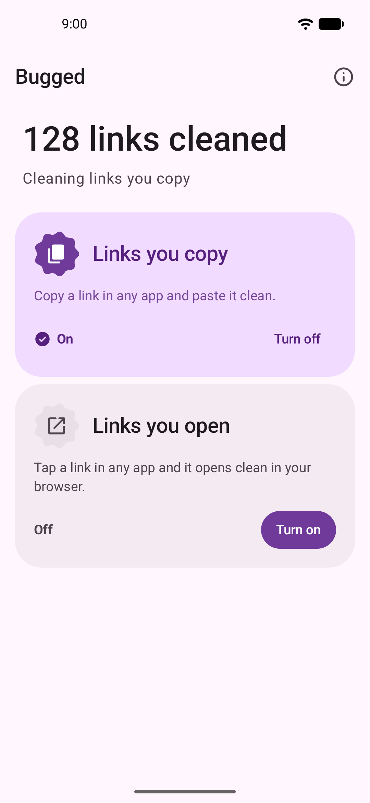
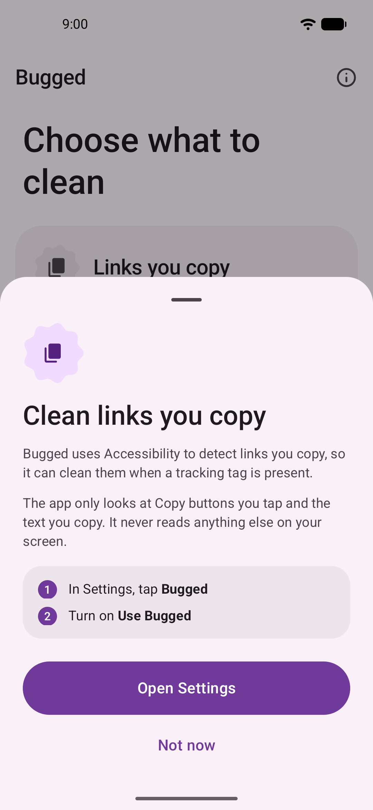
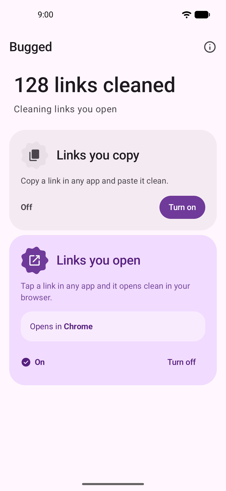

# Bugged – clean your links

An Android app that removes tracking tags from links you copy and open. Many links carry a tag that tells sites who shared them and what you tapped. Bugged cuts it off, and the link opens the same page.

#### Links you copy

- Copy a link in any app and paste it clean.
- Bugged uses Accessibility to detect links you copy. It only looks at Copy buttons you tap and the text you copy.

#### Links you open

- Tap a link in any app and it opens clean in your browser.
- Set Bugged as your default browser app. It cleans each link you tap and passes it to the browser you picked. It never loads the page itself.

#### Cleaning rules

- Removes tracking tags such as `utm_source`, `fbclid` and `gclid`, and site-specific ones such as YouTube's `si`.
- Unwraps redirect links such as `google.com/url?q=…` to their destination.
- Bugged removes a tag only when several maintained lists agree on it, because a broken link is worse than a missed tag. The lists are AdGuard, Brave, ClearURLs, Firefox, uBlock Origin, Neat URL and Actually Legitimate URL Shortener Tool.

#### Offline and private

- Works offline. Bugged has no internet access, so nothing leaves your phone.
